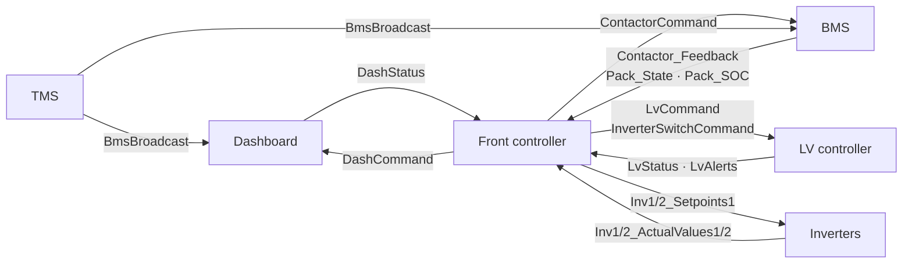
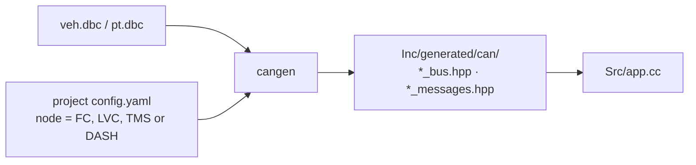

# CAN communication

All coordination between boards happens over two classic CAN buses, both
configured for **500 kbit/s**:

| Bus | Nodes | Purpose |
|---|---|---|
| **Vehicle** | Dashboard, front controller, LV controller, TMS, BMS, IMD, GPS, Raspberry Pi | Driver requests, power state, contactors, temperatures, telemetry |
| **Powertrain** | Front controller, left inverter, right inverter, Raspberry Pi (logger, receive-only) | Inverter enable, speed/torque setpoints, inverter feedback |

The front controller is the bridge between the two control domains: it reads
driver and dashboard inputs from the vehicle bus and sends motor commands on
the powertrain bus.

## How message IDs are built

The DBC header documents an intended ID convention:

| Digit | Meaning |
|---|---|
| First | `1` special, `2` periodic, `3` sensor, `4` debug |
| Second | ECU the message belongs to, not always the sender: `0` front controller, `1` LV controller, `2` TMS, `3` dashboard, `4` Raspberry Pi |
| Third (periodic only) | `0` command, `1` status, `2` alerts |

Many IDs follow it: `FcStatus` is **201** (periodic, front controller, status),
`LvCommand` is **210** (periodic, belongs to the LV controller, sent by the
FC), `DashCommand` is **230** (sent by the FC, belongs to the dashboard),
`LvAlerts` is **212**, and `Accumulator_Soc` is **300** (sensor, front
controller).

The convention is not enforced. Some periodic frames use the third digit for
another purpose: `FcCounters` is 203, `TMSValues` is 204,
`InverterSwitchCommand` is 213, and `LvDcdc` is 214. `InverterStatus` (241)
fits the `2x1` shape but is sent by the FC to the dashboard. `TuningParams`
(340) fits `3xn` but carries configuration, not sensor data.

The 1570–1574 block is a separate BMS command/status range: 1570 is FC-sent and
1571–1574 are BMS-sent. Always decode by the DBC message name and signals, not
by the ID digits alone.

The BMS, IMD and GPS add 11-bit frames outside this convention. The TMS sends
its thermistor broadcast, `BmsBroadcast`, as a 29-bit extended frame
(`0x1839F380`). The DBC also defines `ThermistorBroadcast` (`0x18FEF1FE`) as a
second 29-bit frame, but the current application does not send it.

## Main message flow



The arrows show message flow, not physical wiring. All vehicle-bus nodes are
attached to the same shared bus.

The most important startup messages are:

| Message | Sender → receiver | Rate | Purpose |
|---|---|---|---|
| `DashStatus` | Dashboard → FC | ~50 Hz | Screen state and selected profile |
| `DashCommand` | FC → dashboard | 10 Hz | Acknowledge startup steps, speed, SOC, reset |
| `ContactorCommand` | FC → BMS | 100 Hz | Positive, negative and precharge contactor requests |
| `Contactor_Feedback` | BMS → FC/LV/dashboard | External | Inverted open/closed feedback |
| `Pack_State` | BMS → FC and dashboard | External | Pack voltage and current |
| `Pack_SOC` | BMS → FC | External | State of charge and maximum pack voltage |
| `InverterSwitchCommand` | FC → LV | 100 Hz | Request to close the shared inverter switch |
| `LvStatus` | LV → FC | 10 Hz | LV state and switch acknowledgment |
| `Inv1/2_Setpoints1` | FC → inverters | 100 Hz | Enable bits, speed and torque limits |
| `Inv1/2_ActualValues1/2` | Inverters → FC | External | Readiness, speed, current, temperature, error |
| `FcStatus` | FC → Pi | 10 Hz | Governor, accumulator and motor states |
| `LvAlerts` | LV → FC/dashboard/Pi | 10 Hz | IMD, BMS and HSD fault flags |

`LvCommand`, sent by the FC at 100 Hz, carries the brake-light request. Its
receipt is also how the LV controller knows the FC is online. The exact bit
layout and every signal are defined in `projects/veh.dbc` and
`projects/pt.dbc`.

## Generated C++ types

The DBC files describe the wire format. `scripts/cangen` turns them into C++
classes for each ECU:



Each project gets only the messages it sends or receives. For example, the FC
gets vehicle and powertrain headers; the TMS gets only the vehicle bus.

The generated bus provides:

```cpp
VehBus veh_can{can_base};

veh_can.Send(tx_message);

auto latest = veh_can.GetRxDashStatus();   // latest value, retained
auto cleared = veh_can.PopRxDashStatus();  // latest value, then clear
```

## Latest value, not a queue

CAN reception is a **one-message mailbox per message type**. A new frame
replaces the previous frame of that type.

- `GetRx...()` returns the latest decoded value and keeps it.
- `PopRx...()` returns it and clears the slot.
- There is no automatic age check or timeout.

This is the most common source of confusion when reading startup code:

!!! warning "`has_value()` does not mean the sender is alive"
    A dashboard that sent `DashStatus` once and then stopped still leaves a
    valid value in the mailbox. The front controller will keep reading that
    last state unless the application adds its own timeout. Most startup paths
    do not add one.

The accumulator is the main exception: it pops `Pack_State` and `Pack_SOC` and
invalidates pack voltage if no matching pair arrives for more than 500 ms.

## Frames, signals and binary values

These are classic CAN buses, not CAN FD. A frame carries at most **8 data
bytes** and is identified by an **11-bit or 29-bit ID**. The ID names the
message, not a destination: every node on the bus sees the frame. Most messages
here use 11-bit IDs; the thermistor broadcast from the TMS uses a 29-bit
extended ID.

A DBC file describes how the bits inside each frame are interpreted:

- the message ID, length and sender;
- each signal's start bit, width, byte order, signedness, scale, offset, range
  and unit;
- names for enumerated values.

A signal stores a raw integer. The physical value is:

```text
physical = raw × scale + offset
```

For example, `BppsPercent` has scale `0.1` and unit `percent`. Two details
matter in this repository:

- **State numbers are part of the DBC.** The FC governor state value `1` is not
  used; `WAIT_DRIVER_SELECT` is `2`.
- **Units are not always what the name suggests.** The dashboard's `> 0.20`
  brake check is **0.20 percentage points**, not 20 percent.

## Watching the bus

With a SocketCAN adapter and the repository checked out:

```bash
cd projects
bash monitor_veh.sh    # vehicle bus, can1, veh.dbc
bash monitor_pt.sh     # powertrain bus, can0, pt.dbc
```

These scripts configure the interface with `ip` and open `cantools monitor`.
They require Linux, `iproute2` and `cantools`. The Linux
interface names are a local convention; they are not the STM32 CAN peripheral
numbers.
