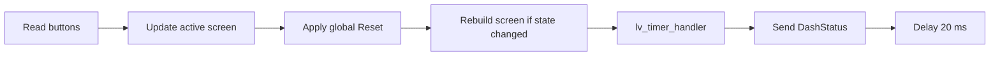
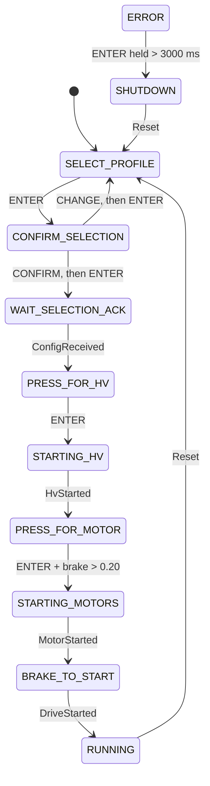

# Dashboard

The dashboard is the driver interface: an STM32F469I Discovery board running
LVGL 9.3 on a 4-inch display. It uses two physical buttons, **SCROLL** and
**ENTER**, instead of a touchscreen. The board reports its current screen state
and selected profile over vehicle CAN; the front controller decides what
happens next.

## One loop

The loop period is the 20 ms delay plus the work, so the dashboard runs at
roughly 50 Hz rather than a guaranteed 50 Hz. `DashStatus` contains a wrapping
8-bit counter, the screen state and the selected profile.

## Screens and startup

| State | Screen | Driver sees | Advances on |
|---|---|---|---|
| `SELECT_PROFILE` | Profile roller | Five event profiles | ENTER |
| `CONFIRM_SELECTION` | Confirm menu | Chosen profile, CONFIRM/CHANGE | ENTER on a menu item |
| `WAIT_SELECTION_ACK` | Waiting screen | Waiting for front controller | `ConfigReceived` |
| `PRESS_FOR_HV` | Start HV | Press ENTER | ENTER |
| `STARTING_HV` | Precharge | Progress bar | `HvStarted` |
| `PRESS_FOR_MOTOR` | Start motors | Press ENTER and brakes | ENTER + brake data > 0.20 |
| `STARTING_MOTORS` | Starting motors | Starting motors | `MotorStarted` |
| `BRAKE_TO_START` | Start driving | Press brakes | `DriveStarted` |
| `RUNNING` | Telemetry | Speed, HV, LV and temperatures | Only global Reset |
| `SHUTDOWN` | Shutting down | Shutdown message | Only global Reset |
| `ERROR` | Error screen | Raw alert-bit indices | ENTER held > 3 s → `SHUTDOWN` |

Profiles are `Default`, `Launch`, `Skidpad`, `Endurance` and `Tuning`. The
dashboard sends the selected profile in every `DashStatus` frame, but the front
controller only stores it: the profile does not currently change torque or
vehicle behavior.

`LOGO` exists in the DBC but is never selected: the dashboard boots directly
into `SELECT_PROFILE`.

## Buttons

The two inputs are active-low GPIOs. `InvertedDigitalInput` turns a low
electrical level into a logical press.

- A new level is accepted only if at least **200 ms** have passed since the
  previous accepted edge.
- The first update takes the current level as a baseline and suppresses both
  edges.
- Each button exposes `PosEdge()`, `NegEdge()`, `IsPressed()` and
  `GetHeldDuration()`.

This is edge spacing, not a requirement for 200 ms of stable input. A held
button at boot produces no press edge.

## Reset

After the active screen updates, `Display::Update()` checks
`DashCommand.Reset`. If it is true and the dashboard is not already in
`SELECT_PROFILE`, the pending transition is replaced with `SELECT_PROFILE` and
the screen is rebuilt.

This is the only ordinary way back to profile selection after driving.

## Running screen

The running screen has three columns:

| Column | Content |
|---|---|
| HV | Pack current arc, pack voltage, state of charge |
| Thermals | BMS low/high temperature, motor and inverter temperatures |
| LV | LV battery voltage/current, FC status, CAN indicator, speed |

The current arc is a 100-sample moving average of `Pack_State.Pack_Current`.
The speed comes from `DashCommand.Speed`. Most numeric labels are
integer-truncated. The speedometer is labeled `km/h`, but the DBC value is in
`mph` and the screen does not convert it. The HV voltage label can also be
wrong above 255 V because the FC truncates that field to 8 bits before sending
it.

!!! warning "Some indicators are decorative"
    The `FC: OK` label is a constant, and the green CAN indicator does not
    monitor traffic. A disconnected ECU can leave its last value on screen
    because the dashboard does not check message age.

## CAN inputs

| Message | Dashboard use |
|---|---|
| `DashCommand` | Reset, startup acknowledgments, precharge percent, speed, SOC |
| `BppsSteerDebug` | Brake qualification before motor start |
| `FcAlerts` | Raw bit indices on the error screen |
| `BmsBroadcast` | Battery min/max temperature |
| `InverterStatus` | Motor and inverter temperatures |
| `Accumulator_Soc` | Pack voltage and state of charge |
| `Pack_State` | Pack current |
| `LvDcdc` | LV voltage and current (the LV application does not currently send it) |

There is one physical vehicle bus. The dashboard reaches it through CAN1; the
front controller reaches the same bus through CAN2. The dashboard configuration
also requests powertrain headers, but the application does not create a second
bus or send on the powertrain bus.

## Brake threshold

The dashboard's motor-start screen compares `BppsPercent()` with `0.20`.
`BppsPercent` has DBC scale `0.1` and unit `percent`, so this is **0.20
percentage points**, not 20 percent. Raw values 0 and 1 decode to 0 and 0.1 and
fail; raw value 2 decodes to a float slightly above 0.20 and passes, as do
higher values.

The front controller uses a separate brake check for entering `RUNNING`: its own
brake sensor must read above **10%**.

## Error and shutdown limitations

The dashboard does not consume `DashCommand.Errored` or `HvShutdown`, and no
normal screen transition enters `ERROR`. The error screen can display bit
indices and can request shutdown if entered, but the ordinary driver flow has
no path to it. The running screen has no shutdown button action.

