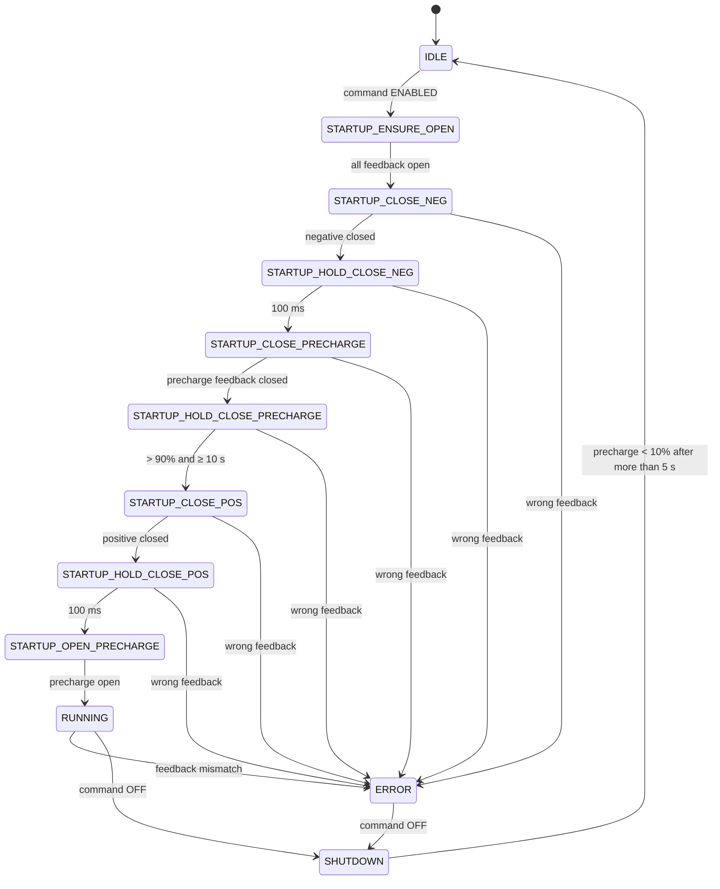
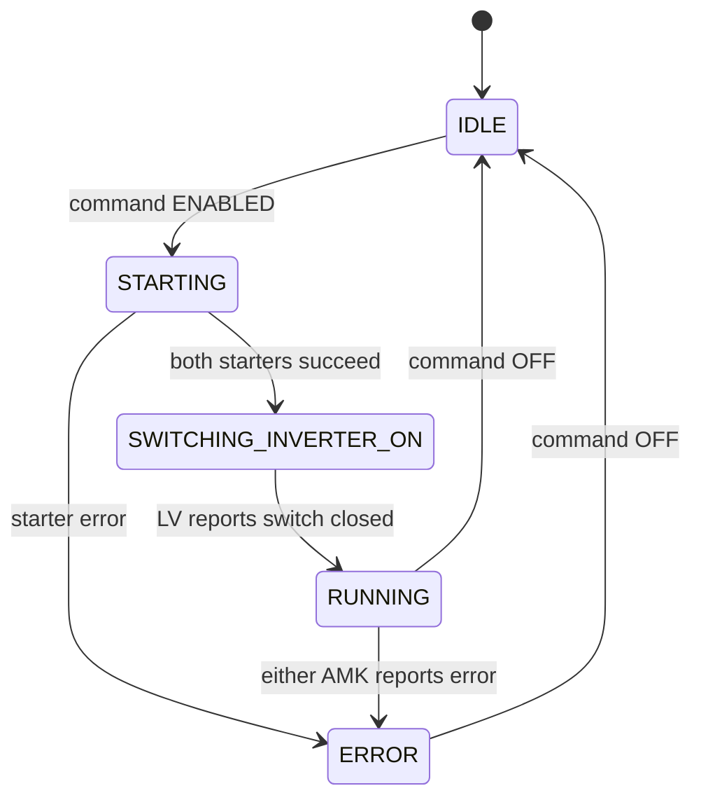

# Front controller

The front controller (FC) is the brain of the car. It owns the
[global governor](startup.md), sequences the high-voltage contactors, reads the
driver's pedals and steering, computes torque, and runs the two AMK inverter
state machines. It also exchanges status with the LV controller and publishes
telemetry that the Raspberry Pi logger records.

The FC is the only vehicle ECU that transmits on both CAN buses:

- **Vehicle CAN** (CAN2) — dashboard, LV, TMS, BMS, telemetry.
- **Powertrain CAN** (CAN1) — left and right inverters.

It works with the other boards:

- **Dashboard** — sends the driver's requested startup step and receives
  acknowledgments.
- **LV controller** — supplies FC power and controls the inverter supply and
  shared switch.
- **Raspberry Pi** — logs CAN telemetry and can request ECU flashing; it does
  not command HV or torque.

## What runs when

`Src/app.cc` creates three FreeRTOS tasks after initialization:

| Task | Period | Priority | Work |
|---|---:|---:|---|
| `task_100hz` | 10 ms | 3 | Read sensors; check pedal plausibility; run global governor; update accumulator, vehicle dynamics and motors; send contactor, brake-light, switch and inverter commands |
| `task_10hz` | 100 ms | 2 | Toggle debug LED; mirror LV fault LEDs; check DBC hash; read suspension and HSD current; send `FcStatus`, `DashCommand`, alerts and debug frames |
| `task_1hz` | 1000 ms | 1 | Send `FcGitHash` |

`main()` also drives dashboard power high once at boot. The dashboard stays
powered as long as the FC has power.

## Global governor

The governor is the top-level startup state machine. It is documented in full,
with its transition table and dashboard handshake, on
[Startup and the global governor](startup.md).

In one sentence: the dashboard sends a requested screen state, and the governor
turns that request into accumulator and motor enable commands, a torque
permission, and a ready-to-drive sound.

## Accumulator

The accumulator object owns the three contactor commands and validates the BMS
feedback. Its state is reported in `FcStatus.AccumulatorState`.



Important details:

- **Feedback is inverted.** `true` means a contactor is open; `false` means it is
  closed.
- Precharge voltage is measured by an FC analog input and averaged to reduce
  noise.
- Pack voltage comes from `Pack_State`; maximum pack voltage comes from
  `Pack_SOC`. If a matching pair stops arriving for 500 ms, precharge completion
  is blocked.
- A wrong contactor state in most startup steps latches
  `AccumulatorContactorWrongState` and enters `ERROR`. `STARTUP_ENSURE_OPEN`
  only waits for all feedback to read open, so a welded contactor there stalls
  startup without a fault. Missing feedback also just waits.
- The low-SOC check is commented out.

## Motors and inverters

The motor coordinator owns two `Amk` objects, one per inverter, plus a starter
state machine for each. Its state is reported in `FcStatus.MotorState`.



The AMK state machine is the low-level per-inverter sequence:

```text
OFF → SYSTEM_READY → STARTUP_bDCON → STARTUP_bENABLE
    → STARTUP_bINVERTER → STARTUP_X140 → RUNNING
```

The starter layer waits for the inverter's ready and DC-on acknowledgments
before moving through the AMK states. Both motors must reach `STARTUP_X140`
before the FC asks the LV controller to close the shared inverter switch. The
FC proceeds to `RUNNING` when `LvStatus.MotorControllerSwitchClosed` is true.

While running, the FC sends each inverter a setpoint frame containing enable
bits, a speed request and positive/negative torque limits. Feedback arrives in
`Inv1/2_ActualValues1/2`.

## Driver inputs and torque

The FC reads two accelerator pedal sensors, brake pressure, steering angle,
four wheel-speed inputs, suspension travel and the precharge monitor.

Driver torque is computed at 100 Hz:

| Condition | Result |
|---|---|
| Both APPS sensors disagree by more than 10% | Torque request = 0; `AppsImplausible` alert |
| APPS above 25% while brake is pressed | Torque request = 0 until APPS falls below 5% (`EV47Active`) |
| Otherwise | Request = main APPS percentage |

`IsBrakePressed()` uses the FC's own brake sensor and a threshold of **10%**.
This is the brake check that lets the governor enter `RUNNING`.

The pedal request then goes through the active pedal map (`linear` by default,
`quadratic` available) and into vehicle dynamics. Dynamics produces a left and
right request with opposite speed signs; the torque limits are what actually
restrict drive torque. Torque vectoring is disabled and the traction-control
scale factor is currently fixed at 1.

## Outputs

| Output | Controlled by |
|---|---|
| Accumulator contactors | `ContactorCommand` over vehicle CAN |
| Inverter enable, speed and torque | `Inv1/2_Setpoints1` over powertrain CAN |
| Shared inverter switch request | `InverterSwitchCommand` over vehicle CAN |
| Brake light request | `LvCommand.BrakeLightEnable` over vehicle CAN |
| Dashboard power | `DASHBOARD_HSD_EN` GPIO, set high at boot |
| Ready-to-drive sound | `RTDS_EN` GPIO, on for ~2 s after entering `RUNNING` |
| IMD and BMS warning LEDs | GPIOs mirrored from `LvAlerts`; default on if no alert frame |
| Debug LED | Toggled at 10 Hz |
| HSD current sensing | GPIO mux and ADC sampled locally; values are not transmitted |

## Diagnostics

The FC sends `FcAlerts` with bits for pedal plausibility, accumulator state,
motor start/run errors, dashboard boot timeout, CAN errors, missing inverter CAN
and HSD overcurrent. The HSD overcurrent bit is always false in this revision.
`FcStatus` carries the governor, accumulator, motor and per-inverter states plus
a DBC-valid flag.

The DBC-valid flag compares the FC's generated hash with the LV controller's
hash. It is telemetry only; it does not block startup.

