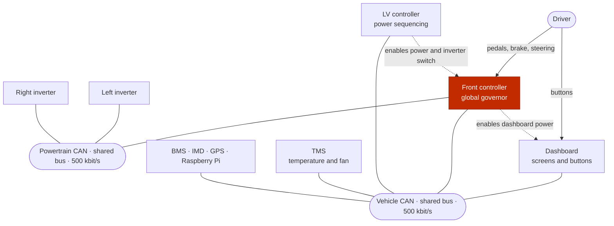

# System architecture

racecar firmware

## Four ECUs, two CAN buses

The car is controlled by four STM32 boards. They share one **vehicle CAN bus**;
the front controller also sits on a second **powertrain CAN bus** for the two
inverters. Every board runs its own application, and logical control and status
coordination happens through CAN messages.

The vehicle bus is a single shared bus: every node hears every vehicle
message, and each node decides which messages it cares about. The front
controller is the only ECU that transmits on the powertrain bus; the Raspberry
Pi logger also listens to both buses.

Most CAN IDs follow a convention that encodes a message class, an ECU number
and, for periodic messages, a command/status/alert type. The DBC files define
the exact payloads.

## The four boards

| Board | Main job | MCU | CAN |
|---|---|---|---|
| **Front controller (FC)** | Brain of the car: decides when HV and motors may run; sequences contactors; reads driver inputs; computes torque; talks to both inverters | STM32F767 | Vehicle + powertrain |
| **LV controller (LV)** | Powers up the other boards and subsystems; controls inverter supply and switch; TSSI; cooling; brake light; current sensing | STM32F767 | Vehicle |
| **Dashboard** | Driver interface: LVGL screens, two physical buttons, profile selection and live telemetry | STM32F469 Discovery | Vehicle |
| **TMS** | Reads six accumulator thermistors; reports temperatures to the BMS; computes cooling-fan duty | STM32F767 | Vehicle |

External devices on the vehicle bus include the **BMS**, **IMD**, **GPS** and a
**Raspberry Pi** for logging and flashing. The two **AMK inverters** are on the
powertrain bus and are not implemented in this repository.

## How a start request travels

1. The driver selects a profile on the dashboard and confirms it.
2. The dashboard sends its screen state in `DashStatus` over vehicle CAN.
3. The front controller's **global governor** reads that state and commands its
   accumulator state machine to enable HV.
4. The accumulator sends `ContactorCommand` to the BMS; the BMS closes the
   contactors and reports `Contactor_Feedback` and pack voltage back.
5. Once HV is running, the dashboard asks to start motors. The front controller
   starts both inverters, the LV controller closes the shared inverter switch,
   and the front controller enters `RUNNING` when the brake is pressed.

The detailed sequence and all governor states are on
[Startup and the global governor](startup.md).

## What each board owns

No board writes another board's GPIO. Ownership is split by physical function:

| Output or decision | Owner |
|---|---|
| When HV and motors may run; when torque is allowed | Front controller |
| Opening and closing the three HV contactors | Front controller commands; BMS executes |
| Inverter enable, speed and torque setpoints | Front controller |
| Dashboard power, ready-to-drive sound, IMD/BMS warning LEDs | Front controller GPIO |
| Power to FC, LV peripherals, accumulator electronics, inverter supply | LV controller GPIO |
| Shared inverter switch | LV controller GPIO, requested by FC |
| Brake light, TSSI, cooling pumps and fans, HSD current sensing | LV controller |
| Screen, buttons, driver profile | Dashboard |
| Accumulator temperature reporting and fan speed | TMS |

The **hardware shutdown circuit** is separate from all of this software. A
shutdown-circuit event removes power directly; it does not wait for a CAN
message or a governor state.

## Where to go next

- **[:material-layers-triple: Software layout](software.md)**

    How `projects/`, `lib/` and `tests` fit together, and how an ECU is built.

- **[:material-transit-connection-variant: CAN communication](can.md)**

    Buses, messages, generated code and what "received" really means.

- **[:material-state-machine: Startup and governor](startup.md)**

    The full power-on-to-torque sequence and the global state diagram.

- **[:material-car-electric: Front controller](front-controller.md)**

    Governor, accumulator, motors, driver inputs and torque.

- **[:material-power-plug: LV controller](lv-controller.md)**

    Power sequencing, cooling, TSSI and the inverter switch.

- **[:material-monitor-dashboard: Dashboard](dashboard.md)**

    Screens, buttons, profiles and telemetry.

- **[:material-thermometer: TMS](tms.md)**

    Thermistors, BMS reporting and fan control.

- **[:material-tools: Build and tools](tools.md)**

    PlatformIO, CAN generation, flashing, logging and documentation.

