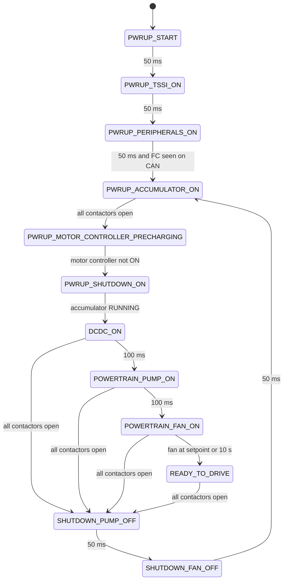

# LV controller

The LV controller (LV) is the power-sequencing board. It enables low-voltage
power to the other ECUs and subsystems, controls the inverter supply and shared
inverter switch, and manages the status indicator, cooling and brake light.

It has its own power governor. This is **not** the same state machine as the
front controller's global governor: the LV decides when power is available, and
the FC decides when HV and torque are allowed.

## Power governor



| State | Main action | Leaves when |
|---|---|---|
| `PWRUP_START` | Everything off; FC, IMU/GPS, pumps and shutdown circuit low | 50 ms |
| `PWRUP_TSSI_ON` | TSSI enabled | 50 ms |
| `PWRUP_PERIPHERALS_ON` | FC and IMU/GPS power on | 50 ms and any `LvCommand` received |
| `PWRUP_ACCUMULATOR_ON` | Accumulator electronics enabled | BMS says all contactors are open |
| `PWRUP_MOTOR_CONTROLLER_PRECHARGING` | Inverter supply enabled | Motor-controller state is not `ON` |
| `PWRUP_SHUTDOWN_ON` | Shutdown circuit enabled | Accumulator reports `RUNNING` |
| `DCDC_ON` | DCDC control is currently commented out | 100 ms |
| `POWERTRAIN_PUMP_ON` | Both cooling pumps on | 100 ms |
| `POWERTRAIN_FAN_ON` | Fan setpoint 100% | At setpoint or 10 s |
| `READY_TO_DRIVE` | No new action; LV power is ready | All contactors open |
| `SHUTDOWN_PUMP_OFF` | Pumps off | 50 ms |
| `SHUTDOWN_FAN_OFF` | Fan setpoint 0% | 50 ms, then back to accumulator startup |

`READY_TO_DRIVE` means **the LV power sequence is ready**. It does not grant
motor torque; that is the FC global governor's decision.

`SHUTDOWN_DRIVER_WARNING` and `SHUTDOWN_COMPLETE` exist in the DBC but have no
active incoming path in this revision.

## Modules

| Module | Responsibility |
|---|---|
| `Accumulator` | Enables accumulator electronics; reads contactor feedback; reports all-open/running |
| `Motor_Controller` | Controls inverter precharge, main supply and shared switch; reports its state and switch position |
| `TSSI` | Red/green status indicator; reads IMD and BMS fault inputs; red flashes on fault |
| `Fans` | PWM ramp for powertrain cooling; enable outputs are currently forced low |
| `HSD` | Six high-side drivers, 14 current-sense channels; sets `HsdOvercurrent` |
| `Brake light` | Mirrors `LvCommand.BrakeLightEnable` to a GPIO; defaults on if no command |
| `Suspension` | Reads rear travel sensors 3 and 4 and sends `SuspensionTravel34` |
| `DCDC` | Low-voltage DC/DC measurement and control; not called by the current application |
| `Scheduler` | Fixed-period task table for 100 Hz, 10 Hz and 1 Hz work |

## Inverter supply and switch

The motor-controller module has its own small state machine:

```text
OFF → PRECHARGING (2 s) → PRECHARGING_HANDOFF (50 ms) → ON
```

It drives three GPIOs: precharge enable, main supply enable and the shared
inverter switch. The switch follows `InverterSwitchCommand.CloseInverterSwitch`
from the FC; if no command has been received, the switch is opened.

`GetSwitchClosed()` returns the **requested software value**, not an independent
physical switch feedback. The FC treats this as the acknowledgment that lets
the motors enter `RUNNING`.

## Outputs

| Output | Purpose |
|---|---|
| Front-controller power | Powers the FC |
| IMU/GPS power | Powers navigation peripherals |
| Accumulator electronics power | Powers the BMS/accumulator electronics |
| Shutdown-circuit enable | Arms the hardware shutdown path |
| Inverter precharge, main supply and switch | Brings the inverters online |
| Cooling pump 1/2, fan 1/2, fan PWM | Powertrain cooling |
| TSSI enable, red and green | High-voltage status indicator |
| Brake light | Driver brake lamp |
| HSD enable/select lines | Multiplexed current sensing |
| VICOR enable | DC/DC control (present but unused by the application) |

## Scheduling and boot status

!!! danger "The LV application is not executable as written"
    In this revision `main()` does **not** call `Initialize()`, so the HAL,
    clocks, GPIO, ADC, CAN and timer setup are skipped. The scheduler is also
    called once with a timestamp that is never refreshed, so registered tasks
    cannot continue on advancing time. The state diagram above describes the
    intended governor logic, not a verified boot on hardware.

    Constructor-order issues also affect the fan PWM and motor-controller
    enable lines.

Even with a working scheduler, `PWRUP_MOTOR_CONTROLLER_PRECHARGING` advances
while the motor-controller state is **not** `ON`, so it does not wait for the
inverter precharge to complete.
