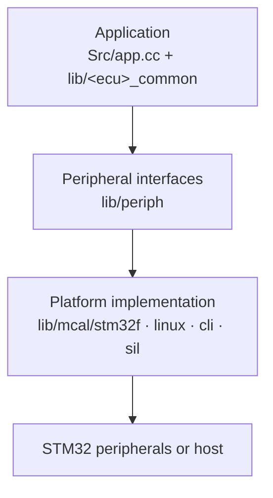

# Software layout

The repository has three top-level code areas:

```
racecar/
├── projects/        one folder per ECU (the application)
├── lib/             shared code used by the applications
└── scripts/         build, CAN, flashing and logging tools
```

Each of the four ECUs is a **PlatformIO project** with one C++ entry point,
`Src/app.cc`. There is no separate bindings or platforms folder in the
production ECUs: the application constructs its objects directly and talks to
hardware through the shared `periph` interfaces.

## One ECU project

```
projects/front_controller/
├── Src/
│   ├── app.cc           application: objects, main(), tasks or scheduler
│   ├── main.c           CubeMX reset/clock support
│   ├── adc.c can.c gpio.c ...
│   └── stm32f7xx_*.c   CubeMX HAL and interrupt support
├── Inc/                 CubeMX headers, thresholds, tuning, generated CAN
├── lib/                 symlinks to the shared libraries this ECU uses
├── config.yaml          which DBC and CAN node to generate
└── platformio.ini       build environment and source selection
```

CubeMX still owns the low-level setup: clocks, pin modes, ADC/timer handles and
interrupts. The FC, dashboard and TMS applications call those `MX_*_Init()`
functions from `Initialize()` inside `app.cc`, then start their scheduled work.
The LV controller defines `Initialize()` but does not call it in this revision
(see [LV controller](lv-controller.md)).

## Shared libraries

The shared code is split by purpose:

| Library | Purpose |
|---|---|
| `lib/fc_common/` | Front-controller logic: accumulator, motors/AMK, driver interface, vehicle dynamics, suspension, alerts |
| `lib/lv_common/` | LV module implementations: inverter supply, cooling fans, TSSI, brake light, HSD sensing, scheduler |
| `lib/tms_common/` | TMS logic: temperature sensor conversion, BMS broadcast, fan controller |
| `lib/periph/` | Platform-independent interfaces: analog input/output, digital I/O, PWM, CAN |
| `lib/mcal/stm32f/` | STM32F implementation of `periph` |
| `lib/mcal/linux/`, `cli/`, `sil/` | Host, terminal and simulation implementations |
| `lib/can/`, `lib/atomic_buffer/` | Raw CAN frames, typed bus wrapper and latest-value receive buffer |
| `lib/lookup_table/`, `moving_average/`, `sls095/`, `cobs/` | Small reusable algorithms and encodings |

A project does not copy these libraries. It has symlinks in `projects/<ecu>/lib/`
that point back to the repository `lib/` folder. PlatformIO follows the
symlinks and builds only what the project references.



This is why the same control code can be unit-tested or run against host
adapters without changing the application. On the car, only the STM32
implementation is linked.

## Tests

Tests live next to the library they cover, for example:

```
lib/lookup_table/test/test_lookup_table.cc
lib/moving_average/test/test_moving_average.cc
lib/sls095/test/test_sls095.cc
```

`lib/fc_common/test/` also contains a vehicle-dynamics test, but that library
has no `native` environment, so CI does not run it.

Run a library's native tests with PlatformIO:

```bash
pio test -d lib/lookup_table -e native
```

The tests are numerical and host-side. They do not replace a hardware test of
CAN timing, GPIO wiring or contactor feedback.

## Building

Build one ECU from its project folder:

```bash
cd projects/front_controller
pio run -e vehicle
```

Upload it with an ST-Link attached:

```bash
pio run -e vehicle -t upload
```

The `vehicle` environment targets the real board. The other environments that
appear in older demo projects (`cli`, `linux`) are development aids and are
not used by the four vehicle ECUs.

## CAN code generation

Each project's `config.yaml` names the DBC files and the node this ECU plays:

```yaml
canGen:
  outputPath: Inc/generated/can
  busses:
    - name: veh
      node: FC
      dbcFile: "../veh.dbc"
    - name: pt
      node: FC
      dbcFile: "../pt.dbc"
```

The `cangen` tool is a PlatformIO library dependency, so generated headers are
refreshed automatically before a build. Output goes to
`Inc/generated/can/` and contains only the transmit and receive types for that
node. See [CAN communication](can.md).

## Demos

`projects/demo/` contains small teaching projects. Some still use the older
`main.cc` + `bindings` + `platforms/` structure. They are useful for learning
PlatformIO and peripherals, but they are not part of the four-ECU firmware.
