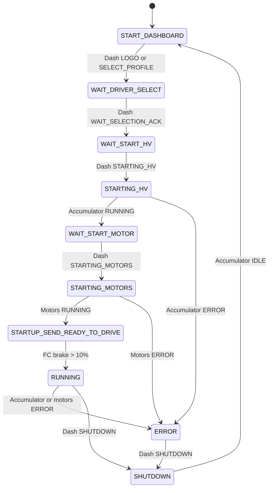
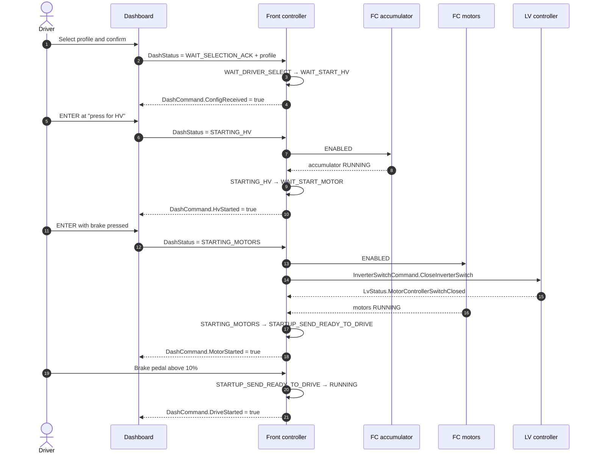
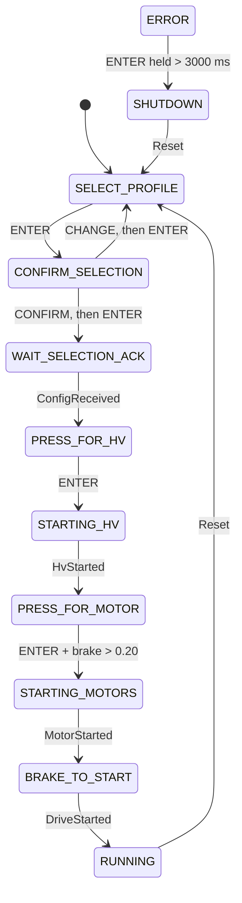

# Startup and the global governor

Startup is a conversation, not one state machine. The dashboard reports what the
driver is asking for; the front controller decides whether to act; the
accumulator, inverters and LV controller do the physical work.

| Layer | Responsibility |
|---|---|
| Dashboard | Shows prompts and sends the driver's requested next step in `DashStatus` |
| **Front controller governor** | Owns the overall startup state and decides when HV, motors and torque are allowed |
| FC accumulator | Sequences the three contactors and monitors feedback |
| FC motors | Runs the two AMK inverter startup sequences |
| LV controller | Powers the ECUs, accumulator electronics and inverter supply; closes the shared inverter switch |
| TMS | Reports temperatures; not part of the startup handshake |

## Global governor

This is the front controller's top-level state machine. It is the single source
of truth for whether the car is allowed to drive.

State numbers come from `FcStatus.State` in `veh.dbc`. Value `1` is unused.

| State | Value | FC outputs | Advances when | Fault behavior |
|---|---:|---|---|---|
| `START_DASHBOARD` | 0 | Accumulator OFF, motors OFF, torque 0 | Dashboard reports `LOGO` or `SELECT_PROFILE` | After 10 s, sets `DashboardBootTimeout` alert but keeps waiting |
| `WAIT_DRIVER_SELECT` | 2 | OFF, OFF, torque 0 | Dashboard reports `WAIT_SELECTION_ACK`; profile is stored | No timeout |
| `WAIT_START_HV` | 3 | OFF, OFF, torque 0 | Dashboard reports `STARTING_HV` | No timeout |
| `STARTING_HV` | 4 | Accumulator ENABLED, motors OFF, torque 0 | Accumulator reaches `RUNNING` | Accumulator `ERROR` → `ERROR` |
| `WAIT_START_MOTOR` | 5 | Accumulator ENABLED, motors OFF, torque 0 | Dashboard reports `STARTING_MOTORS` | Does not check accumulator error here |
| `STARTING_MOTORS` | 6 | Both ENABLED, torque 0 | Motors reach `RUNNING` | Motors `ERROR` → `ERROR`; does not check accumulator error here |
| `STARTUP_SEND_READY_TO_DRIVE` | 7 | Both ENABLED, torque 0 | FC's own brake reading is above 10% | No timeout and no subsystem-error check |
| `RUNNING` | 8 | Both ENABLED, driver torque allowed | Stays until error or shutdown | Accumulator/motor `ERROR` → `ERROR`; dashboard `SHUTDOWN` → `SHUTDOWN` |
| `SHUTDOWN` | 9 | OFF, OFF, torque 0 | Accumulator reaches `IDLE` | Waits for the accumulator only |
| `ERROR` | 10 | OFF, OFF, torque 0 | Dashboard reports `SHUTDOWN` | No automatic recovery |

The ready-to-drive speaker turns on **after** entering `RUNNING` and stays on for
about 2 seconds. Torque is not held at zero during that time.

!!! note "The interlock branch is inactive"
    There is a local `hvil_interrupt` check after the governor switch, but the
    variable is always `false` in this revision. It creates no transition. The
    physical shutdown circuit is separate from this software path.

## Driver and dashboard handshake

`DashCommand` is a set of repeated level bits, not one-shot events:

| Bit | True when |
|---|---|
| `ConfigReceived` | FC governor is in `WAIT_START_HV` |
| `HvStarted` | Accumulator is `RUNNING` |
| `MotorStarted` | Motor coordinator is `RUNNING` |
| `DriveStarted` | FC governor is in `RUNNING` |
| `Reset` | FC governor is in `START_DASHBOARD` |
| `Errored` | FC governor is in `ERROR` |
| `HvShutdown` | FC governor is in `SHUTDOWN` |

## Dashboard state machine

The dashboard's screen state is the driver's request. It is sent over CAN every
loop, including while driving.

`LOGO` exists in the DBC but is never selected by the dashboard, which boots
directly into `SELECT_PROFILE`.

**Global Reset:** after the active screen updates, `Display::Update()` checks
`DashCommand.Reset`. If it is true and the dashboard is not already in
`SELECT_PROFILE`, it forces `SELECT_PROFILE`.

!!! warning "The error and shutdown screens are incomplete"
    No normal screen transition enters `ERROR`, and the running screen has no
    shutdown action. The FC sends `DashCommand.Errored` and `HvShutdown`, but
    the dashboard does not consume either bit. The error screen's
    hold-ENTER-to-shutdown path is therefore not reachable through the normal
    driver flow.

## What happens underneath

The governor only requests; two FC modules do the physical work:

- **Accumulator:** ensure all contactors open, close negative, close precharge,
  wait for more than 90% and at least 10 s, close positive, then open precharge.
  Contactor feedback is inverted, and a wrong or missing state can fault or
  stall the sequence.
- **Motors:** start both AMK inverters. When both reach the X140 handoff, the FC
  asks the LV controller to close the shared inverter switch. The LV reports its
  requested switch state, and the motors enter `RUNNING`.

See [Front controller](front-controller.md) for the detailed state diagrams and
fault paths.

## Timing

| Context | Nominal period | Startup-relevant work |
|---|---:|---|
| FC control task | 10 ms (100 Hz) | Sensors, governor, accumulator, dynamics, motors, commands |
| FC status task | 100 ms (10 Hz) | `FcStatus`, `DashCommand`, alerts, diagnostics |
| FC identity task | 1000 ms (1 Hz) | Git revision |
| Dashboard loop | 20 ms delay + work | Buttons, active screen, `DashStatus` |
| LV tasks | 10 / 100 / 1000 ms intended | Governor, modules, status (see the LV scheduler note) |
| TMS tasks | 100 / 1000 ms | Temperature reporting, fan-duty calculation, Git revision |

Key delays and thresholds:

| Item | Value |
|---|---:|
| Minimum precharge time | 10 s |
| Precharge complete | > 90% of pack voltage |
| Contactor step hold | 100 ms |
| Pack voltage data timeout | 500 ms |
| Shutdown discharge complete | < 10% after > 5 s |
| FC brake-to-drive threshold | > 10% |
| Dashboard brake-to-start threshold | > 0.20 percentage points |
| Dashboard boot alert | > 10 s |
| Ready-to-drive speaker | ~2 s |

The FC's `elapsed` counters are software counters incremented by 10 per 100 Hz
update. They are not wall-clock deadlines, and a late task does not change the
increment.

Most governor waits have no timeout. If the dashboard stops sending, its last
`DashStatus` remains valid and can still drive a transition because there is no
sender-age check. Missing contactor feedback or a missing `LvStatus` likewise
leaves the relevant state machine waiting. The pack-voltage check is the main
exception at 500 ms.

## Shutdown and restart

A dashboard `SHUTDOWN` request is accepted in `RUNNING` and `ERROR`. The FC then:

1. commands the accumulator and motors OFF;
2. the accumulator opens all three contactors;
3. the accumulator waits for precharge below 10% and more than 5 seconds, then
   reports `IDLE`;
4. the FC returns to `START_DASHBOARD`.

`DashCommand.Reset` is true while the FC is in `START_DASHBOARD`, so the
dashboard returns to profile selection. The dashboard remains powered
throughout; its power is controlled by the FC GPIO, not by this state machine.

The physical **shutdown circuit** can remove power independently of any of
these software states. This repository documents the software requests and
feedback it can observe, not the complete electrical response of that circuit.
