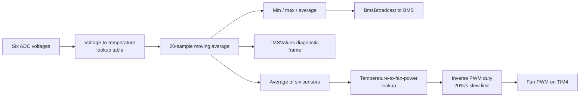

# TMS

The thermal management system (TMS) is the simplest ECU. It reads six
accumulator thermistors, filters them, reports temperatures on vehicle CAN, and
computes the accumulator cooling-fan duty. The fan PWM output is not actually
started in this revision. The TMS does not participate in the startup handshake
and has no startup/fault governor of its own.

## Tasks

| Task | Period | Work |
|---|---:|---|
| `task_10hz` | 100 ms | Read and filter six sensors; send `BmsBroadcast` and `TMSValues`; update fan duty; toggle debug LEDs; handle CAN-flash request |
| `task_1hz` | 1000 ms | Send `TmsGitHash` |

Both are FreeRTOS tasks with static stacks. The application starts them and
then starts the scheduler.

## Data flow

## Temperature measurement

Each sensor is connected to an ADC channel and converted with a lookup table
from the sensor datasheet. Readings outside the table clamp to its endpoints.
There is no open/short detection or per-sensor validity flag.

Each sensor then passes through a 20-sample moving average. The average is
preloaded with zeros and always divides by 20, so the first samples are biased
toward zero: a constant 40 °C input reads about 2 °C on the first sample and
reaches 40 °C after twenty samples.

## CAN reporting

### `BmsBroadcast` — every 100 ms

This eight-byte frame mimics an Orion thermistor module:

| Field | Meaning |
|---|---|
| `ThermModuleNum` | Module 0 |
| `LowThermValue`, `HighThermValue` | Lowest and highest integer temperature |
| `AvgThermValue` | Integer mean temperature |
| `NumThermEn` | 6 |
| `HighThermID`, `LowThermID` | Zero-based sensor indices |
| `Checksum` | Sum of the logical bytes plus `0x41`, truncated to 8 bits |

The BMS consumes this frame as if it came from its own thermistor module.

### `TMSValues` — every 100 ms

A six-byte diagnostic frame with one value per sensor. Each field is built as
`static_cast<uint8_t>(temperature × 50)`. At normal positive temperatures this
exceeds the 8-bit range, so this frame is **not a reliable Celsius
representation** as implemented.

### `TmsGitHash` — every 1 second

Commit hash and dirty flag. Unlike the FC and LV, the TMS application does not
send a DBC hash.

## Fan control

The fan power is based on the **mean** of all six filtered temperatures:

| Mean temperature | Requested fan power |
|---|---|
| ≤ 19 °C | 0% |
| 19–20 °C | Linear 0 → 30% |
| 20–50 °C | Linear 30 → 100% |
| ≥ 50 °C | 100% |

The fan input uses inverse logic, so the PWM duty is `100 - power`. Duty changes
by at most 20 percentage points per second, which is 2 points per 100 ms update.
Because the mean is used, one hot sensor can be diluted by five cooler ones.

The fan controller has a `Start()` method that both starts the PWM timer and sets
the initial duty. In this revision the application never calls it, and
`MX_TIM4_Init()` configures the timer but does not start the output. The
periodic duty writes alone do not produce an active PWM signal.

## Hardware

| Function | Pin |
|---|---|
| Thermistors 1–6 | ADC1 channels 10–15, PC0–PC5 |
| Fan PWM | TIM4 channel 1, PB6 |
| Debug green | PE2 |
| Debug red | PA3 |
| Vehicle CAN | CAN2 |

The clock is 96 MHz system / 48 MHz APB1, and CAN is configured for 500 kbit/s.
